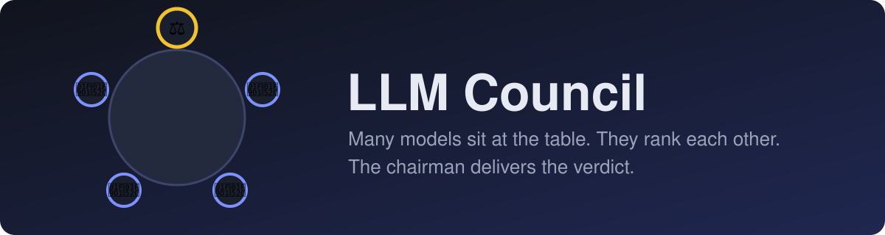
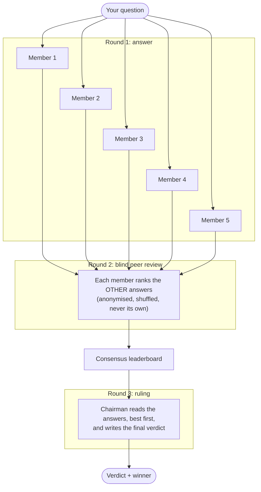

<p align="center">
  
</p>

<h1 align="center">🧙‍♂️ LLM Council</h1>
<p align="center"><b>Several LLMs sit at a round table, rank each other's work blind, and a chairman delivers the verdict.</b></p>
<p align="center">Created by <b>Mujahid Mahfuz</b></p>

<p align="center">
  <a href="https://github.com/mujahidmahfuz/LLM-Council/actions/workflows/ci.yml">
    
  </a>
  
</p>

---

## The idea

Picture four or five scientists around a round table, with a chairman at its head. You pose a question. Each scientist writes an answer on their own. Then they read each other's answers **without names attached**, and rank them. The ranking, not any single opinion, decides who did best. Finally the chairman reads everything and writes the council's ruling.

LLM Council does exactly that with language models, through [OpenRouter](https://openrouter.ai). Judging answers blind and aggregating many judges is the approach studied in
[*Language Model Council: Democratically Benchmarking Foundation Models on Highly Subjective Tasks*](https://arxiv.org/abs/2406.08598) (a copy is in [`docs/`](./docs/2406.08598v4.pdf)).

## How a session works



1. **Answer.** Every member answers the question independently, in parallel (concurrency is capped to respect free-tier limits).
2. **Peer review.** Each member receives the other members' answers labelled `Response A`, `B`, `C`… in random order, with model names hidden, and ranks them. A member never ranks itself.
3. **Consensus.** Rankings are combined into a score from 0% (ranked last by everyone) to 100% (ranked first by everyone). The top score is the council's pick for **best model**.
4. **Verdict.** The chairman, a separate model, sees the answers ordered by that consensus (still anonymous) and writes the final ruling for you.

The council degrades gracefully:

| What goes wrong | What happens |
| --- | --- |
| A member is rate limited or errors | It is retried with backoff, then shown as *failed*; the rest carry on |
| A reviewer returns an unparseable ranking | That review is discarded and listed as an error; other reviews still count |
| Fewer than 3 members answer | Peer review is skipped (a lone reviewer would rank a single answer); the chairman still rules |
| The chairman fails | The top-ranked member's answer is returned, clearly marked as a fallback |
| Every member fails | You get a clear error listing each member's reason |

Answers from other models are treated as untrusted data: reviewer and chairman prompts tell the model to judge them, never obey instructions inside them.

## Quick start

You need Python 3.10+, Node 20+, and a free [OpenRouter API key](https://openrouter.ai/keys).

```bash
git clone https://github.com/mujahidmahfuz/LLM-Council.git
cd LLM-Council

# Backend (http://127.0.0.1:8000)
cd backend
python -m venv venv
source venv/bin/activate          # Windows: venv\Scripts\activate
pip install -r requirements.txt
cp .env.example .env              # then paste your key into .env
uvicorn main:app --reload

# Frontend (http://localhost:5173), in a second terminal
cd frontend
npm install
npm run dev
```

Open <http://localhost:5173> and ask the council something.

> **Free tier note.** One question with peer review makes about 11 model calls (5 answers, 5 reviews, 1 ruling). Free OpenRouter models are rate limited and change often. If a model disappears or a vendor is busy, that seat shows as *failed*; pick other models with `COUNCIL_MODELS`. Untick **Peer review** in the UI to use only 6 calls.

## Configuration

Set these in `backend/.env` (see [`.env.example`](./backend/.env.example)). Only the key is required.

| Variable | Default | Meaning |
| --- | --- | --- |
| `OPENROUTER_API_KEY` | none | Your OpenRouter key (`OPEN_ROUTER_KEY` is accepted too) |
| `COUNCIL_MODELS` | 5 free models from 5 vendors | Comma-separated model ids at the table (1 to 26) |
| `CHAIRMAN_MODEL` | `nvidia/nemotron-3-ultra-550b-a55b:free` | Model that writes the ruling |
| `MAX_CONCURRENT_REQUESTS` | `3` | Parallel calls to OpenRouter |
| `REQUEST_TIMEOUT_SECONDS` | `90` | Per-call timeout |
| `MAX_RETRIES` | `3` | Retries for 429, 5xx and timeouts |
| `MAX_PROMPT_CHARS` | `8000` | Longest accepted question |
| `CORS_ORIGINS` | `http://localhost:5173,http://127.0.0.1:5173` | Browser origins allowed to call the API |

The frontend reads `VITE_API_URL` (default `http://127.0.0.1:8000`) at build time.

Your key stays on the backend: it is never sent to the browser, never logged, and `.env` files are git-ignored.

## API

Interactive docs are served at <http://127.0.0.1:8000/docs>.

| Endpoint | Description |
| --- | --- |
| `GET /health` | `{"status": "ok", "configured": true}` |
| `GET /config` | Council members and chairman (no secrets) |
| `POST /ask-council` | Runs the whole council and returns one JSON result |
| `POST /ask-council/stream` | Same, streamed as newline-delimited JSON events: `stage`, `answers`, `reviews`, `complete` (or `error`) |

```bash
curl -s http://127.0.0.1:8000/ask-council \
  -H 'Content-Type: application/json' \
  -d '{"prompt": "Why is the sky blue?", "peer_review": true}'
```

```jsonc
{
  "question": "Why is the sky blue?",
  "individual_responses": [{ "model": "…", "answer": "…", "error": null }],
  "reviews": [{ "reviewer": "…", "ranking": ["best model", "…"], "error": null }],
  "leaderboard": [{ "model": "…", "score": 1.0, "average_rank": 1.0, "votes": 4 }],
  "winner": "…",                 // best model by consensus (null if peer review was skipped)
  "chairman": "…",
  "council_verdict": "…",
  "verdict_source": "chairman",  // or "fallback" if the chairman failed
  "chairman_error": null
}
```

## Project layout

```
backend/
  main.py              FastAPI app (create_app factory)
  council/
    config.py          Settings from environment variables
    openrouter.py      Chat client with retries and safe error messages
    ranking.py         Prompts, ranking parser, consensus aggregation (pure functions)
    pipeline.py        The three-stage council
    schemas.py         Response models
  tests/               pytest suite (OpenRouter fully mocked)
frontend/              React + Vite round-table UI
docs/                  Reference paper
```

## Development

```bash
# Backend
cd backend
pip install -r requirements-dev.txt
ruff check . && ruff format --check .
pytest --cov

# Frontend
cd frontend
npm run lint && npm test && npm run build
```

CI runs all of the above on every push and pull request.

## License

[Apache 2.0](./LICENSE)
